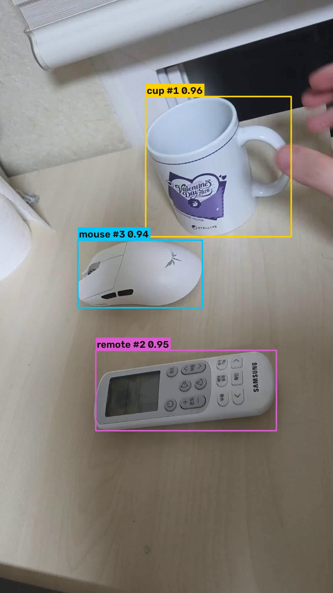
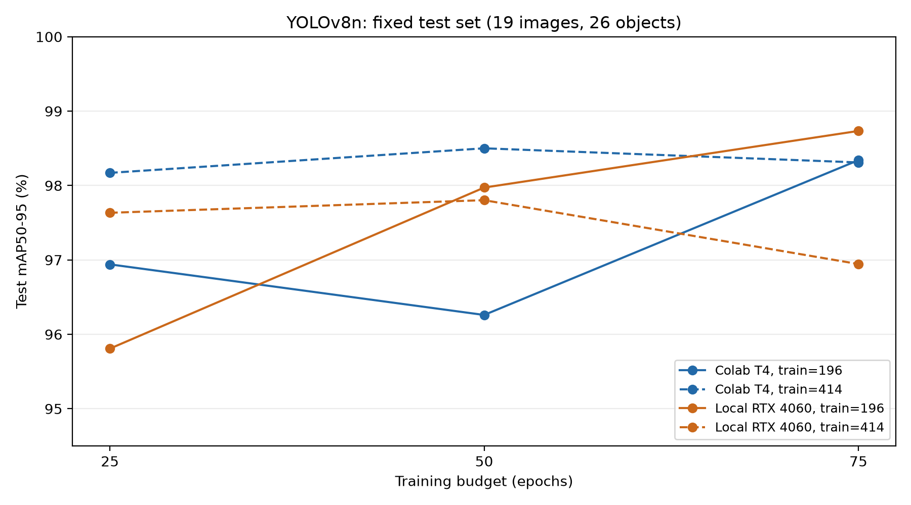

# YOLOv8n Fine-tuning

### 컵·마우스·리모컨 객체 감지 및 추적

직접 촬영한 이미지로 YOLOv8n을 파인튜닝하고, ByteTrack으로 물체의 이동을 추적한 프로젝트입니다.
학습 데이터 수, 에포크, 실행 환경을 바꾸어 총 **12개 실험**을 비교했습니다.

[시연 영상](https://youtube.com/shorts/Bvby948NvQ4) · [최종 모델](models/local_196_75_best.pt) · [전체 실험 결과](results/test_comparison.csv) · [실행 방법](docs/usage.md)

## 시연 영상

<a href="https://youtube.com/shorts/Bvby948NvQ4">
  
</a>

**[▶ YouTube에서 시연 영상 보기](https://youtube.com/shorts/Bvby948NvQ4)**

컵·마우스·리모컨의 감지 박스와 클래스, 신뢰도, 추적 ID, 이동 궤적을 표시했습니다.
원본 전체를 2배속으로 재생한 약 6.72초 영상입니다.

[결과 영상 다운로드](videos/local_196_75_2x.mp4) · [로컬·Colab 비교 영상](videos/comparison_2x.mp4) · [원속도 비교 영상](videos/comparison_full.mp4)

## 최종 모델

**로컬 RTX 4060에서 학습한 `local_196_75_best.pt`를 최종 모델로 선정했습니다.**

| 항목 | 내용 |
|---|---|
| 모델 | 사전 학습된 YOLOv8n 파인튜닝 |
| 학습 환경 | Windows · NVIDIA GeForce RTX 4060 |
| 학습 데이터 | 196장 |
| 학습 에포크 | 75회 |
| 모델 선택 | 검증 성능 기준 `best.pt` |
| 객체 추적 | ByteTrack |

| Precision | Recall | mAP50 | mAP50-95 |
|---:|---:|---:|---:|
| **99.25%** | **100.00%** | **99.50%** | **98.73%** |

동일한 테스트 19장·26객체에서 가장 높은 mAP50-95를 기록했습니다.
영상의 주요 장면에서도 Colab 비교 모델보다 추적 ID 연결이 상대적으로 안정적이었습니다.

**[최종 모델 다운로드](models/local_196_75_best.pt)** · [모델별 결과](models/README.md)

## 실험 결과

모든 실험을 `yolov8n.pt`에서 독립적으로 시작했습니다.
학습 이미지를 **196장 → 414장**으로 늘리고, **25·50·75에포크**를 Colab T4와 로컬 RTX 4060에서 비교했습니다.

아래 값은 각 실험의 `best.pt`를 동일한 테스트셋으로 평가한 **mAP50-95(%)**입니다.

| 학습 환경 | 학습 이미지 | 25회 | 50회 | 75회 |
|---|---:|---:|---:|---:|
| Colab T4 | 196장 | 96.94 | 96.26 | 98.34 |
| Colab T4 | 414장 | 98.17 | 98.50 | 98.31 |
| 로컬 RTX 4060 | 196장 | 95.81 | 97.97 | **98.73** |
| 로컬 RTX 4060 | 414장 | 97.63 | 97.80 | 96.94 |



에포크와 데이터 수를 늘렸을 때 성능이 항상 향상되지는 않았습니다.
테스트셋이 작고 단일 seed로 실행한 결과이므로 작은 차이는 제한적으로 해석했습니다.

[전체 지표 CSV](results/test_comparison.csv) · [학습 손실·검증 성능](results/figures/checkpoint_history.png) · [로컬 학습 시간](results/figures/local_training_time.png) · [결과 해석](docs/results_notes.md)

## 데이터세트

컵(`cup`), 마우스(`mouse`), 리모컨(`remote`)을 직접 촬영하고 Roboflow에서 라벨링했습니다.
촬영 각도·거리·배경을 바꾸고 복수 객체와 손 가림 장면을 포함했습니다.

| 버전 | 학습 | 검증 | 테스트 | 전체 |
|---|---:|---:|---:|---:|
| v1 | 196장 | 39장 | 19장 | 254장 |
| v2 | 414장 | 39장 | 19장 | 472장 |

데이터 증가 비교에서는 기존 검증·테스트 분할을 유지했습니다.
[데이터 구성 및 준비 방법](data/README.md)

## 실행

패키지 설치 후 저장소 루트에서 다음 명령으로 두 모델의 영상 추적 결과를 비교할 수 있습니다.
모델과 원본 영상이 포함되어 있어 영상 실행에는 학습 데이터 ZIP이 필요하지 않습니다.

```powershell
python scripts/compare_video.py --video videos/original/desk_objects.mp4 --local models/local_196_75_best.pt --colab models/colab_414_50_best.pt --out runs/video_comparison --playback-speed 2
```

두 모델의 영상 비교는 동일한 CPU·FP32 조건에서 수행했습니다. LOCAL/COLAB은 학습 환경을 뜻합니다.

[설치·학습·평가 안내](docs/usage.md) · [Colab 노트북](notebooks/colab_experiments.ipynb) · [영상 분석](docs/video_analysis.md)

## 프로젝트 구성

```text
scripts/       데이터 검사, 학습, 평가, 영상 추적, 그래프 생성
models/        학습 모델 7개와 SHA256 체크섬
videos/        원본 및 감지·추적 결과 영상
results/       비교표, 학습 이력, 그래프, 프레임별 예측 기록
configs/       실험 설정
data/          데이터 구성 및 준비 안내
docs/          실험 보고서와 분석 문서
notebooks/     Google Colab 실행 노트북
```

[실험 보고서](docs/report_1_3_to_9.txt) · [실험 구성](docs/submission_checklist.md) · [검증 기록](docs/verification.md)

## 참고

- [Ultralytics YOLO](https://github.com/ultralytics/ultralytics)
- [Ultralytics 학습](https://docs.ultralytics.com/modes/train/) · [평가](https://docs.ultralytics.com/modes/val/) · [추적](https://docs.ultralytics.com/modes/track/)
- [Roboflow](https://roboflow.com/)
- [구성 요소 및 모델 라이선스](THIRD_PARTY_NOTICES.md)
