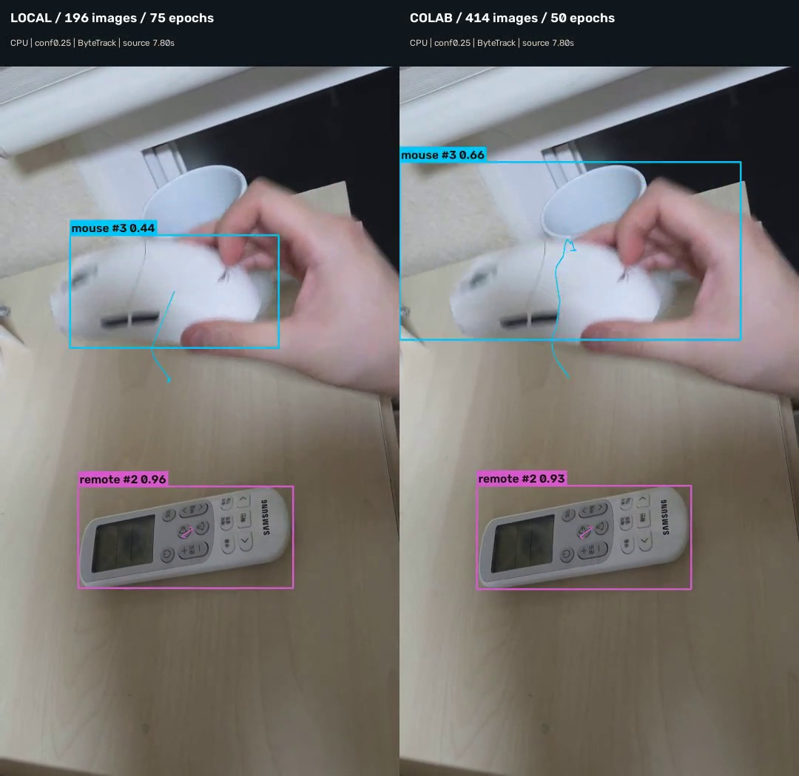

# YOLOv8n 컵 마우스 리모컨 객체 감지 및 추적

직접 촬영한 3개 클래스 데이터로 YOLOv8n을 학습하고, 데이터 수·학습 횟수·실행 환경에 따른 변화를 비교한 기계학습 과제이다.
196장/414장 × 25/50/75에포크 × Colab T4/로컬 RTX 4060의 **12개 실험**을 동일한 테스트 19장·26객체로 평가하였다.

**공개 GitHub 주소: 공개 저장소 생성 후 이 위치에 실제 주소 입력.** 제출 파일은 로컬 Git에 기록하였으며 GitHub 공개·업로드는 아직 하지 않았다.

## 결과와 최종 모델

| 구분 | 학습 이미지 | 에포크 | Precision | Recall | mAP50 | mAP50-95 |
|---|---:|---:|---:|---:|---:|---:|
| 최종 시연 후보 · 로컬 RTX 4060 | 196 | 75 | 99.25% | 100.00% | 99.50% | 98.73% |
| 비교 후보 · Colab T4 | 414 | 50 | 99.18% | 100.00% | 99.50% | 98.50% |

세부 12개 결과: [비교 CSV](results/test_comparison.csv), [해석 및 출처](docs/results_notes.md).
최종 시연 모델은 [local_196_75_best.pt](models/local_196_75_best.pt)이다. 새 영상의 주요 장면에서 상대적으로 안정적인 ID 연결을 보였다.
차이는 작은 테스트셋과 단일 seed에서 관찰한 결과이며, 모든 환경에서 우수하다고 일반화하지 않는다.


## 감지 및 추적 영상

| 파일 | 내용 |
|---|---|
| [최종 로컬 2배속](videos/local_196_75_2x.mp4) | 전체 원본을 유지한 약 6.72초 시연 |
| [Colab 2배속](videos/colab_414_50_2x.mp4) | 동일 영상·동일 추론 설정의 비교 후보 |
| [좌우 비교 2배속](videos/comparison_2x.mp4) | 왼쪽 로컬, 오른쪽 Colab |
| [비교 원속도](videos/comparison_full.mp4) | 약 13.43초, 장면 확인용 |
| [원본](videos/original/desk_objects.mp4) | 직접 촬영한 1080×1920, 30fps, 403프레임 |

감지 박스, 클래스, 신뢰도, **추적 ID와 중심점 궤적**을 표시하였다. ByteTrack을 사용하였다.
추론은 원본 403프레임 전부에 수행한 다음 재생 속도만 2배로 바꾸었다. 2배속 결과는 60fps이며 무음이다.
화면 상단 source 시각은 원본 기준이다. 이번 비교의 추론 장치는 두 모델 모두 CPU이다.

**강의자료의 문구는 5초 분량이지만, 현재 영상은 전체 2배속을 원하는 사용자 요청에 따라 약 6.72초이다.**
정확히 5초라는 조건을 충족했다고 표기하지 않는다. [요구사항 및 남은 제출 항목](docs/submission_checklist.md)을 참고한다.



[장면별 분석](docs/video_analysis.md)과 [프레임별 예측 기록](results/video/)도 제공한다.
프레임별 정답을 구축하지 않았으므로 영상의 출력 빈도를 정확도·Recall로 해석하지 않는다.

## 저장소 구성

```text
scripts/       데이터 검사, 독립 학습, 테스트 평가, 영상 추적·비교, 그래프 생성
configs/       실험 조건 요약
data/          데이터 구성과 별도 다운로드 안내 (원본 ZIP 미포함)
models/        제공된 실제 best.pt 7개와 SHA256 체크섬
videos/        최신 결과 영상과 직접 촬영한 원본
results/       12개 테스트 결과, 로컬 시간, 체크포인트 이력, 영상 예측 CSV
docs/          보고서 1.3~9장, 한계, 제출 체크리스트
notebooks/     Google Colab 실행용 노트북
```

과거 실행 파일 전체가 남아 있지는 않아 학습·평가 스크립트는 제공된 실험 기록을 바탕으로 정리한 재실행용 코드이다.
현재 코드로 과거의 수치를 비트 단위로 똑같이 재현한다고 보장하지 않는다.

## 설치

Python 3.12 또는 3.13의 가상환경을 사용한다. 아래 명령은 저장소 루트의 PowerShell에서 실행한다.

```powershell
py -3.12 -m venv .venv
.\.venv\Scripts\python.exe -m pip install --upgrade pip
# 추론만 CPU로 실행할 때
.\.venv\Scripts\python.exe -m pip install torch==2.14.1 torchvision==0.29.1 --index-url https://download.pytorch.org/whl/cpu
.\.venv\Scripts\python.exe -m pip install -r requirements.txt
```

RTX 4060에서 학습하려면 CPU 설치 명령 대신 다음과 같이 CUDA 빌드를 설치하고 실제 CUDA 사용 여부를 확인한다.
설치 환경에 맞는 빌드는 [PyTorch 공식 설치 안내](https://pytorch.org/get-started/previous-versions/)를 기준으로 선택한다.

```powershell
.\.venv\Scripts\python.exe -m pip install torch==2.14.1 torchvision==0.29.1 --index-url https://download.pytorch.org/whl/cu130
.\.venv\Scripts\python.exe -c "import torch; print(torch.__version__); print(torch.cuda.is_available()); print(torch.cuda.get_device_name(0) if torch.cuda.is_available() else 'CUDA unavailable')"
```

이하 `python`은 위 가상환경의 Python을 의미한다. 활성화하지 않았다면 `python` 대신 `.\.venv\Scripts\python.exe`를 쓴다.
Colab은 [실행 노트북](notebooks/colab_experiments.ipynb)을 이용한다.

## 데이터 준비와 학습

[데이터 준비 안내](data/README.md)에 따라 Roboflow 버전 1·2를 YOLOv8 ZIP으로 별도 확보하고 `datasets/v1`, `datasets/v2`에 푼다.
원본 Roboflow 프로젝트는 Private이므로 저장소만 복제해 학습 데이터까지 자동으로 받을 수는 없다.
API 키와 데이터 ZIP은 커밋하지 않는다.

```powershell
python scripts/audit_dataset.py --data datasets/v1/data.yaml --compare datasets/v2/data.yaml
python scripts/train.py --data datasets/v1/data.yaml --epochs 25 --device 0 --name local_196_25
python scripts/train.py --data datasets/v1/data.yaml --epochs 50 --device 0 --name local_196_50
python scripts/train.py --data datasets/v1/data.yaml --epochs 75 --device 0 --name local_196_75
python scripts/train.py --data datasets/v2/data.yaml --epochs 25 --device 0 --name local_414_25
python scripts/train.py --data datasets/v2/data.yaml --epochs 50 --device 0 --name local_414_50
python scripts/train.py --data datasets/v2/data.yaml --epochs 75 --device 0 --name local_414_75
```

각 실행은 원래 `yolov8n.pt`에서 시작한다. 이전 실험의 best.pt를 이어 학습하지 않는다.
입력640, batch16, seed0, workers2, optimizer auto, patience0으로 실행하며 검증 성능으로 best.pt를 저장한다.
결과는 `runs/train/`에 저장되고 같은 이름을 재사용하면 별도 폴더가 생성된다.
첫 사전 학습 모델 다운로드에는 인터넷이 필요하다. GPU가 없는데 GPU를 지정하면 명확한 오류를 내도록 하였다.

## 테스트셋 평가

```powershell
python scripts/evaluate.py --model models/local_196_75_best.pt --data datasets/v1/data.yaml --device cpu --name local_196_75
python scripts/evaluate.py --model models/colab_414_50_best.pt --data datasets/v2/data.yaml --device cpu --name colab_414_50
```

`split=test`를 명시해 학습 없이 평가한다. GPU가 있으면 `--device 0`을 사용할 수 있다.
결과 지표 JSON과 평가 그림은 `runs/evaluate/`에 저장된다.
학습 경로가 다른 컴퓨터의 절대 경로여도 현재 데이터 위치로 새 설정을 만들며 원본 data.yaml은 변경하지 않는다.

## 영상 추적 재실행

두 모델·원본 영상이 이미 포함되어 있어 데이터 ZIP 없이도 이 단계는 실행할 수 있다.

```powershell
python scripts/compare_video.py --video videos/original/desk_objects.mp4 --local models/local_196_75_best.pt --colab models/colab_414_50_best.pt --out runs/video_comparison --playback-speed 2
```

원속도와 전체 2배속 MP4, 비교 영상, CSV, JSON을 생성한다. 현재 비교 코드는 동일 CPU/FP32 조건으로 두 모델을 실행한다.
평가용 정답은 생성하지 않는다. `--inspect-only`를 추가하면 추론 없이 입력 정보와 표본 장면만 확인한다.

## 그래프 재생성과 기록 검증

```powershell
python scripts/plot_results.py
python scripts/verify_submission.py
python -m unittest discover -s tests -v
```

기존 테스트 수치를 새 평가 없이 덮어쓰지 않으며, 재실행 결과는 `runs/`에 분리한다.
모델 체크섬과 영상 길이·프레임 수, 결과표의 조건 조합을 검사할 수 있다.

## 보고서와 경험

[보고서 1.3~9장](docs/report_1_3_to_9.txt)은 기존 1.1·1.2 뒤에 옮길 본문이다.
에포크·데이터 수·환경 비교, 작은 테스트셋의 한계, 오검출 및 ID 변화, 패키지 호환성과 Colab 세션 복원 경험을 포함한다.
최종 HWP/PDF는 별도로 완성해야 하며, 공개 GitHub 주소는 업로드 후 실제 주소로 바꾸어야 한다.

## 참고 및 사용한 구성 요소

- [Ultralytics 학습](https://docs.ultralytics.com/modes/train/)
- [Ultralytics 검증 및 테스트](https://docs.ultralytics.com/modes/val/)
- [Ultralytics ByteTrack 및 추적](https://docs.ultralytics.com/modes/track/)
- [Roboflow](https://roboflow.com/)
- [구성 요소 및 모델 라이선스 표기](THIRD_PARTY_NOTICES.md)
